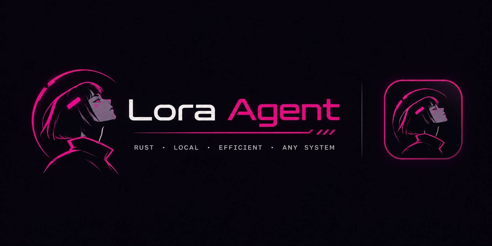

# Lora Agent



**Lora Agent** is an open-source, local-first Rust runtime for running GGUF text models and giving them strictly scoped tool assistance on personal computers. It is engineered from the ground up for memory safety, default-deny authorization, crash-resilient storage, and process-isolated native inference.

[](https://github.com/hami9/Lora-Agent/actions/workflows/rust.yml)
[](https://github.com/hami9/Lora-Agent/actions/workflows/docs.yml)
[](https://opensource.org/licenses/Apache-2.0)

---

## Key Highlights

- **Local-First & Offline**: Zero network dependencies for model admission, inference, file reading, or audit journaling.
- **Process-Isolated Native Worker (`llama.cpp` FFI + Deterministic Modes)**: Native C++17 inference backend (`llama.cpp` pin `7d516e25ead4653169236b3f90d13f7bd8629724` / tag `b12125` behind `--features native-llama-cpp`) alongside a deterministic offline backend, communicating over private 32-bit length-prefixed anonymous pipes with real-time `ggml_abort_callback` cancellation, UTF-8 streaming piece reassembly, and `<tool_call>` tag filtering.
- **Streaming GGUF v2/v3 Header Parser & Chunked Hashing**: Bounded reader parses all 13 GGUF metadata value types (including nested arrays and vocabulary tables) and all `ggml` quantization block sizes directly from the file header without loading multi-gigabyte model weights into memory, paired with 1 MiB chunked SHA-256 verification.
- **Hardware Intelligence Engine (HIE)**: Pressure-aware admission planner evaluates real-time system memory and VRAM to prevent thrashing and out-of-memory crashes before model load.
- **Default-Deny Policy Gate**: Capability-based security model binding operations to callers, runs, normalized resource scopes, and short-lived epochs.
- **Untrusted Observation Envelopes**: File contents and tool outputs are strictly isolated as untrusted data inside model context, preventing prompt-injection privilege escalation.
- **Single-Writer WAL Persistence**: Local SQLite database with ordered transaction commits, schema version gating, pre-dispatch intent journaling, and startup crash reconciliation.
- **Opt-in Loopback API & Desktop Shell**: Loopback-only HTTP/SSE daemon with Host/Origin DNS-rebinding protection (`R08`) alongside a WCAG 2.2 AA compliant desktop interface.

---

## Workspace Architecture

```text
├── Cargo.toml                  # Workspace root (version = "0.1.0")
├── crates/
│   ├── lora-protocol/          # v1 32-bit BE JSON framing, closed schemas & streaming GGUF v2/v3 parser
│   ├── lora-core/              # App service, SQLite store, registry, HIE, policy gate & RAG
│   └── lora-platform/          # OS scoped executor, hardware probe, lock & child supervision
├── workers/
│   └── llama/                  # Isolated llama.cpp worker (C++17 FFI shim + deterministic engine)
├── apps/
│   ├── cli/                    # Trusted terminal composition root (lora)
│   ├── api/                    # Opt-in loopback HTTP/SSE daemon (lora-api)
│   └── desktop/                # Desktop shell view-model & UI bridge (lora-desktop)
├── tests/fixtures/             # Deterministic synthetic GGUF fixtures & adversarial tests
├── benchmarks/                 # Reproducible performance case manifests
└── docs/                       # Architecture specifications and ADRs
```

---

## Versioning Policy

Lora Agent follows a strict Semantic Versioning progression:
- **`0.0.x` (e.g. `0.0.1`, `0.0.2`)**: Pre-release iterative updates, bug fixes, and qualification iterations.
- **`0.x.0` (e.g. `0.1.0`, `0.2.0`)**: Major feature milestones and subsystem additions.
- **`1.0.0`**: Production-ready release following full platform qualification and soak testing.

---

## Quick Start

### Prerequisites

- **Rust**: 1.80+ (stable channel) with `rustfmt` and `clippy`
- **C/C++ Build Tools**: Visual Studio Build Tools (Windows MSVC) or `build-essential` / `clang` (Linux / macOS) plus `cmake` for `--features native-llama-cpp`
- **Python**: 3.10+ (for documentation validation and packaging)

### Building and Testing

```sh
# Clone repository (include submodules for the native llama.cpp worker)
git clone --recurse-submodules https://github.com/hami9/Lora-Agent.git
cd Lora-Agent

# Format check and Clippy lints
cargo fmt --all -- --check
cargo clippy --workspace --all-targets -- -D warnings

# Build all workspace binaries (deterministic worker by default)
cargo build --workspace --locked

# Optional: build worker linked against vendored llama.cpp (requires CMake + C++17 toolchain)
cargo build -p lora-llama-worker --features native-llama-cpp

# Run unit, integration, and qualification tests (71+ test cases)
cargo test --workspace --locked

# Validate documentation and architecture diagrams
python -B scripts/docs.py check
```

---

## CLI Usage

The primary binary is `lora` located at `target/debug/lora` (or `target/release/lora`):

```sh
# 1. Inspect hardware sensors and runtime health
lora inspect

# 2. View active risk mitigation matrix (R01 through R18)
lora risk-matrix

# 3. Generate a deterministic synthetic GGUF fixture for offline smoke testing
lora generate-fixture ./test-model.gguf

# 4. Import model into content-addressed blob store
lora import ./test-model.gguf --alias my-model

# 5. Evaluate HIE admission plan for a requested context window
lora plan --model my-model --context 2048

# 6. Run local offline chat
lora chat --model my-model --prompt "Summarize local-first safety invariants."

# 7. Ask a scoped question against an approved workspace directory
lora ask --model my-model --scope ./my-project --prompt "What does configuration recommend?"

# 8. Check artifact compatibility against GGUF matrix
lora compatibility --filename qwen-3b-q4_k_m.gguf

# 9. Compute context window token allocation
lora context-budget --window 2048 --output 512 --user 256
```

---

## Documentation Index

| Subsystem | Specification |
| --- | --- |
| Core Architecture | [Architecture](docs/ARCHITECTURE.md) |
| System Overview & User Journey | [System overview](docs/SYSTEM_OVERVIEW.md) |
| Competitive Landscape | [Competitive research](docs/COMPETITIVE_RESEARCH.md) |
| Technical Stack & Dependencies | [Technology stack](docs/TECH_STACK.md) |
| Inference Engine & Isolation | [Inference engine](docs/INFERENCE_ENGINE.md) |
| Hardware Intelligence Engine | [Hardware intelligence](docs/HARDWARE_INTELLIGENCE.md) |
| Agent Runtime & Citation Verification | [Agent runtime](docs/AGENT_RUNTIME.md) |
| Security Architecture & Policy Gates | [Security architecture](docs/SECURITY_ARCHITECTURE.md) |
| Model Registry & Staging Lifecycle | [Model management](docs/MODEL_MANAGEMENT.md) |
| Memory, FTS5 & Context Budgeting | [Memory and RAG](docs/MEMORY_AND_RAG.md) |
| Plugin & Extension Isolation | [Plugin system](docs/PLUGIN_SYSTEM.md) |
| Desktop UX & Accessibility | [Desktop UX](docs/DESKTOP_UX.md) |
| Loopback API & HTTP Security | [API and SDK](docs/API_AND_SDK.md) |
| Platform Support Matrix | [Platform qualification](docs/PLATFORM_SUPPORT.md) |
| Benchmark Plan & Controls | [Benchmark plan](docs/BENCHMARK_PLAN.md) |
| Risk Register & Mitigations | [Risk register](docs/RISK_REGISTER.md) |
| MVP Specification & Deliverables | [MVP specification](docs/MVP_SPECIFICATION.md) |
| Development Roadmap | [Development roadmap](docs/DEVELOPMENT_ROADMAP.md) |
| CI/CD & Release Verification | [CI/CD](docs/CI_CD.md) |
| Contributing Guidelines | [Contributing](CONTRIBUTING.md) |
| Security Reporting Policy | [Security](SECURITY.md) |

---

## Contributing & Governance

Contributions, issue reports, and design discussions are welcome. Please read our [Contributing Guide](CONTRIBUTING.md) and [Code of Conduct](CODE_OF_CONDUCT.md). For security vulnerabilities, refer to [SECURITY.md](SECURITY.md).
