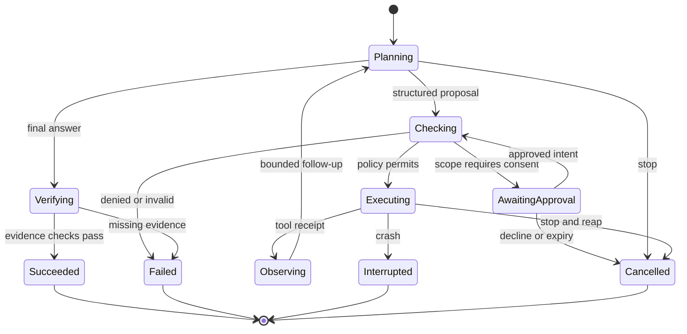

# Agent runtime

A run belongs to one local principal, workspace, model digest and policy revision. The CLI starts the Rust application service in-process. The model proposes a response or a typed action. The service owns the run journal and decides what can execute. Worker output, file content and tool descriptions have no authority to grant access.

## First usable loop

A user selects a directory, chooses Read-only Assistant and asks about a named text file. A qualified local model can request `read_file(root_id, relative_path)` through its tested structured-output template. Validate a closed schema with no unknown keys, bounded strings and one tool call per turn. Resolve the opaque root through the grant store, enforce the current grant, read from the opened regular file, and return a bounded UTF-8 observation with its relative path, observed byte and line ranges, digest of the returned bytes and truncation flag. The answer identifies the source and any omitted data. Unsupported templates offer Chat Only. Agent mode cannot silently treat natural-language text as an invocation.

Cancellation is accepted from any nonterminal state. Persist a single terminal outcome using a state revision compare-and-swap. On startup the exclusive run owner marks unfinished runs interrupted. A later resume creates a new run referencing its predecessor and requires fresh authority. A user may cancel before any tool executes. After a read the host can suppress delivery and discard temporary buffers, but cannot retract text already displayed.

## Ownership and contracts

| Record | Required fields and invariant |
| --- | --- |
| Run | Opaque ID, local principal, workspace, mode, model digest, limits, state revision. The runtime is the sole state writer. |
| Proposal | Run ID, turn, tool ID and version, argument object, proposal ID. Parser rejects multiple actions, unknown fields, malformed UTF-8 and oversized arguments before tool lookup. |
| Permit | Issued by policy for the principal, run, action digest, resolved scope and expiry. Only the trusted executor sees it. Recheck revocation at dispatch and before delivering the read result. |
| Receipt | Invocation ID, outcome, resource identity, relative path, zero-based half-open byte offsets, inclusive one-based line range (absent for empty output), SHA-256 of the excerpt, truncation and error code. Escape control characters when rendered. Bytes are transient by default. |
| Event | Run ID, monotonic sequence, kind, causal invocation ID, safe summary. Commit a state transition and its event together. Clients deduplicate by sequence. |

Persist invocation intent before dispatch. A duplicate invocation ID returns the existing outcome or an interrupted status. Future effectful tools require an explicit reconciliation method before retrying an ambiguous outcome. Failed journal writes block new tool dispatch. A receipt proves that a read occurred. It cannot establish that a model's interpretation is true.

Use fixed initial limits, adjustable downwards by the user. Proposed starting limits are four tool calls, 32 KiB per regular text file, a 120-second run deadline and a finite output-token allowance bounded by the loaded context. Reject binary input and mark reads that stop at a UTF-8 boundary as partial. Never convert an error string into tool input. A policy denial terminates that action. A transient inference failure before dispatch may be retried once on explicit user request. End the run on budget exhaustion and report what was read.

## Execution modes and later tools

| Mode | Authority and behavior |
| --- | --- |
| Chat Only | MVP default. No tools and no filesystem access through the model. |
| Read-only Assistant | MVP opt-in. One bounded read tool, one selected local root, run/session grant. No enumeration, write, subprocess or network. |
| Supervised Agent | Later. Preview diff or typed command and target, present material side effects, collect one-use approval and revalidate resource identities. |
| Scoped Autonomous Agent | Later. Only preapproved, expiring low-risk actions within named resources and budgets. High-risk actions always need fresh approval. |

Future file organization, code edits and documentation workflows can share a checked patch tool with before-image hashes. Repository maintenance uses typed VCS operations. Launch, terminal, browser, desktop, service management, installation and external API access each need separate typed adapters and security qualification. A tool may declare a compensating operation, such as restoring a matching before-image after a patch. Permanent deletion, network submission and observed screen data have no general rollback.

Rig provides reusable provider/tool abstractions and Goose exposes extension-oriented agent workflows. Evaluate these adapters behind the policy point after measuring integration cost. Keep grant resolution, audit and local worker ownership in the core. Later specialist handoffs carry a parent run ID, objective, result schema, remaining budget and a strict subset of authority. Prevent cycles through a bounded depth, join results as untrusted observations and serialize conflicting actions. Introduce multiple agents only if a fixed evaluation improves task completion at acceptable cost. [Rig](https://github.com/0xPlaygrounds/rig) · [Goose](https://github.com/aaif-goose/goose)

## Acceptance

Use a fake planner plus a real scoped filesystem adapter. Test a correct read, invalid JSON, an unknown tool, refusal, revocation during a read, truncation, an injected request to upload a file, cancellation racing a final event, exhausted budgets, and a crash between dispatch and recording the receipt. Repeat the end-to-end path with the exact qualified model/template pair. No test may produce a second terminal event, duplicate a side effect or read an unapproved file. See [security architecture](SECURITY_ARCHITECTURE.md) and [OS integration](OS_INTEGRATION.md).

## Agent Run Outcome Cryptographic Attestation

To prevent anti-spoofing, fabrication, and tampering of agent run responses, evidence citations, and tool invocation receipts, every completed `AgentRunOutcome` produces a domain-separated cryptographic attestation digest (`R17`, `T8`):

- **Domain Separation Prefix**: `AGENT_RUN_DOMAIN_V1 = b"lora.agent.run.v1\0"`
- **Digest Computation (`compute_agent_run_digest`)**: Computes SHA-256 over:
  - Domain separation prefix `lora.agent.run.v1\0`
  - `run_id` (length-prefixed)
  - `final_state` (`planning`, `checking`, `awaiting_approval`, `executing`, `observing`, `verifying`, `succeeded`, `failed`, `interrupted`, `cancelled`)
  - `answer` (length-prefixed UTF-8)
  - Canonical citations count and ordered entries (`relative_path`, line range presence and values, `byte_range`, `excerpt_sha256`, truncation flag)
  - Canonical receipts count and ordered entries (`invocation_id`, `outcome`, `resource_identity`, `relative_path`, `byte_range`, line range, `excerpt_sha256`, truncation flag, error code)
  - `turns_used` (little-endian `u32`)
- **Digest Storage**: Stored in `AgentRunOutcome::outcome_sha256`.
- **Integrity Verification (`verify_agent_run_outcome`)**: Recomputes the canonical digest over the outcome fields and fails closed on digest mismatch, missing digest, or invalid parameter lengths.
- **CLI Commands**:
  - `lora ask ... --export-outcome <PATH>`: Exports the complete verified `AgentRunOutcome` JSON.
  - `lora ask --verify-outcome <PATH>`: Validates cryptographic attestation and prints verification results.
- **REST API**: `POST /v1/agent/verify-outcome`: Validates incoming `AgentRunOutcome` payload against domain `lora.agent.run.v1`.
- **Desktop Shell**: Exposes `"agent_run_attestation": true` on `/api/workflow-status` with UI badge `Agent Run Attestation: Verified Bound (v1)`.
