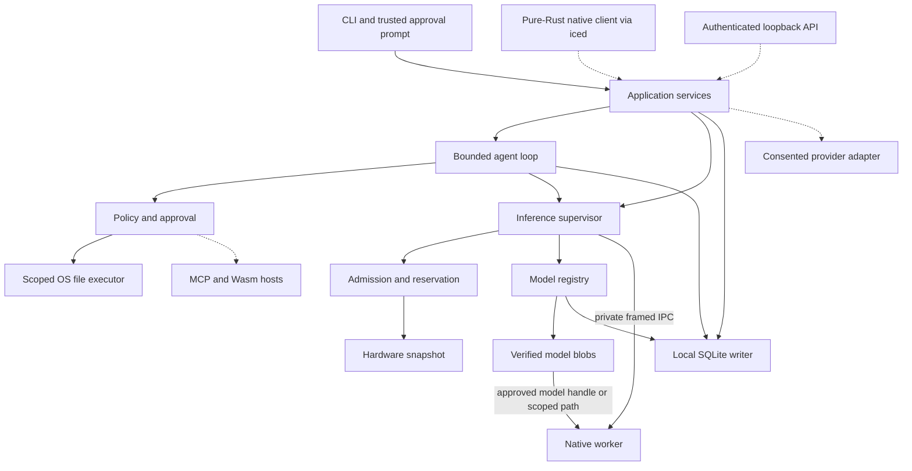

# Lora Agent architecture

**Decision baseline · 2026-11-04 · proposed for implementation.** The first user runs a model they already have, on their own CPU, and asks a question about one approved local file. Success requires a cited answer or an explicit failure, a bounded memory footprint, a working Stop command and no external transmission. The roadmap makes each of these observable.

## Five decisions that shape the build

1. **A Rust modular monolith owns the session.** Start with a CLI process that hosts the application services. Ordinary Rust calls connect components. This keeps admission, grants and run state consistent and avoids a resident service on a low-memory machine. The future desktop app embeds the same core. See [language strategy](adr/0001-language-strategy.md).
2. **Qualify one text path first.** Pin one llama.cpp revision and a small, identified GGUF text-model fixture. Upstream owns tokenization, quantized matrix operations and sampling. Lora owns compatibility checks, scheduling, cancellation and the distinction between documented and tested configurations. See [inference backends](adr/0002-inference-backends.md).
3. **A disposable worker owns native state.** A small worker links the pinned C API and exchanges bounded messages over private inherited pipes. A segfault can end one run while the host records an interruption. OS restrictions and model provenance determine which artifacts a build may open. See [process isolation](adr/0003-process-isolation.md).
4. **Authority stays with the host.** A model proposes structured arguments. A trusted user interface creates a grant, the executor checks it at use time, then an OS adapter opens the file under that scope. A plausible plan, a tool result or a remembered preference cannot grant access. See [security model](adr/0007-security-model.md).
5. **Separate durable metadata from large bytes.** One SQLite writer owns run transitions, model references and audit metadata. Verified model files are immutable blobs referenced by digest. Native handles, prompts in flight and expiring capabilities have explicit lifetimes. See [storage](adr/0005-storage.md).

## Components

Solid arrows indicate request or data flow. Dotted arrows identify later integration points. The front ends call a typed application facade. There is no public listener in the first release.

The privileged broker, trainer and plugin hosts are different executable boundaries with different authority. None belongs in the native inference worker. A remote provider may produce the same generation event types but must pass a distinct egress decision before receiving any content.

## Subsystem contracts

These names describe responsibilities. Exact Rust type names may change before the first protocol fixture is committed.

| Owner | Inputs → outputs | Owned state / failure responsibility |
| --- | --- | --- |
| Application facade | Typed commands with actor, run ID, deadline → acknowledged command, result or ordered events | Sets cancellation scope and user identity. Limits payloads before admission. Future front ends cannot inject trusted approval events through model input. |
| Registry / blob store | User-selected bytes, expected digest if available, provenance and license → immutable model revision | Owns staging, atomic promotion and reference lifecycle. A partial import never appears as runnable. |
| Hardware and admission | Model metadata, requested context, host snapshot, backend capabilities → plan with estimates, reasons and expiring reservation | Tracks reserved memory separately from observations. Rechecks pressure just before loading. Returns an explanation when evidence is insufficient. |
| Worker supervisor | Plan + verified artifact + deadline → capability handshake, stream events and final usage | Owns child, pipes, session handles, watchdog and teardown. A worker generation cannot survive its parent session. |
| Native worker | Bounded protocol frames and model-specific resources → deltas, terminal result or typed error | Owns native model context, sampler and KV memory. Releases them on unload or process exit. Raw pointers never cross IPC. |
| Agent loop | Intent, tool schemas, remaining budgets → proposal, observation or terminal task outcome | Persists step IDs and terminal state, limits retries and detects repetitions. Untrusted strings cannot create an approval. |
| Policy and executor | Verified subject + normalized resource + operation + limits → denial, approval request or one scoped operation | Owns grant issuance, consumption, expiry and revocation. OS adapter checks the opened object; failures are auditable. |
| Persistence and audit | Scoped commands → committed immutable IDs and state projections | Serializes writes, rejects illegal transitions, migrates atomically and reconciles incomplete work after restart. |
| Extensions / future broker | Reviewed manifest, authenticated identity, capability-specific typed call → bounded observation | Independent limits, host-side policy, heartbeat and disable path. No native extension is loaded into the host by default. |
| Memory / training / future providers | Consented sources + purpose → indexed references, evaluated adapter or priced remote stream | Separate retention, provenance and egress rules. An adapter or retrieved chunk cannot expand a grant. |

## Runtime and recovery

A command returns an operation ID before long work begins. Use one correlation ID across import, plan, worker events and audit metadata. Each stream orders its own events, and exactly one terminal result wins completion versus cancellation. The host converts worker exit, invalid frames, incompatible major version and a missed deadline into distinguishable errors. Clients can query the stored outcome after a disconnect. Tokens already displayed remain marked partial on interruption.

The application lock is per user data directory. Only one MVP host can own resource reservations for a store at a time. A second invocation that needs the store reports busy with a retry path. Use an OS-owned lock released on process death. A PID file is diagnostic only. On open, reconcile unfinished runs and staging imports before accepting mutations. No automatic replay of a tool invocation after an uncertain crash. When multi-client access is needed, give a single local host this ownership and retain the same application facade.

Keep private logs, approval UI, tool data and generation streams separate. Rate-limited telemetry includes elapsed time, queue depth and resource high-water marks. Prompt text, file contents and secrets are excluded by default. Cancellation has a control path independent of a full token queue. The host drops an unresponsive worker only after a bounded cooperative stop and waits for confirmed exit before reusing its reservation.

## Dependency direction

Composition roots depend on application services. Those services depend on domain types and narrow ports. Concrete storage, OS, transport and native adapters implement the ports and are constructed by the composition root. No adapter calls back into a front end. An event sink is passed into a command, so a progress update cannot start a second tool invocation. See [repository structure](REPOSITORY_STRUCTURE.md) for the build graph.

## Reading map

| Area | Specifications |
| --- | --- |
| Product and release | [System overview](SYSTEM_OVERVIEW.md), [MVP](MVP_SPECIFICATION.md), [roadmap](DEVELOPMENT_ROADMAP.md), [risks](RISK_REGISTER.md) |
| Runtime selection | [Research](COMPETITIVE_RESEARCH.md), [stack](TECH_STACK.md), [inference](INFERENCE_ENGINE.md), [hardware](HARDWARE_INTELLIGENCE.md), [model registry](MODEL_MANAGEMENT.md) |
| Authority and context | [Agent](AGENT_RUNTIME.md), [OS integration](OS_INTEGRATION.md), [security](SECURITY_ARCHITECTURE.md), [extensions](PLUGIN_SYSTEM.md), [memory and RAG](MEMORY_AND_RAG.md) |
| Clients and targets | [Desktop](DESKTOP_UX.md), [API and SDK](API_AND_SDK.md), [platform support](PLATFORM_SUPPORT.md) |
| Experiments | [Performance](PERFORMANCE_STRATEGY.md), [benchmarks](BENCHMARK_PLAN.md), [training](TRAINING_SYSTEM.md) |
| Maintainers | [Repository structure](REPOSITORY_STRUCTURE.md), [CI/CD](CI_CD.md), [decision index](TECH_STACK.md#decision-records) |

## Where Lora could earn its place

The engineering bet is the connection between model fit, local authority and observable outcomes. Before loading, show which device, context and memory evidence justify the plan. Before tool use, show the exact file and purpose. After a run, show whether the file was read and where an answer came from. Compare completion, failed admissions and policy violations against a simpler runner on the same fixtures. If users see no reduction in failed runs or time spent adjusting settings, keep a conservative static profile. Hardware auto-tuning and a second backend must earn their maintenance cost.
