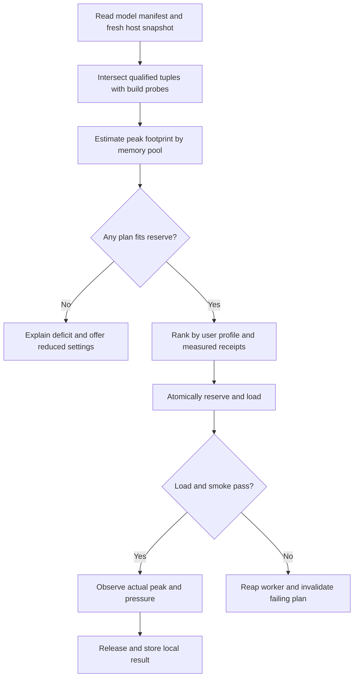

# Hardware intelligence

The planner answers whether a specific artifact, context, worker build and placement can run within current budgets. Persist device fingerprints and tuning receipts; take fresh measurements before admission. Never use “GPU detected” as proof that the pinned engine can execute a kernel.

| Probe | Collect | Missing-data behavior |
|---|---|---|
| CPU/OS | Architecture, ISA, physical/logical topology, optional caches/NUMA, load, process limits, OS build and permitted sandbox features | Choose compatible baseline CPU variant; reject builds requiring absent ISA. Verify SIMD support independently of CPU brand |
| Memory | Available and installed RAM, process/container cap, swap and pressure; discrete VRAM total/free or unified-pool accounting | Ignore swap for fit. Unknown discrete free VRAM requires explicit conservative calibration or CPU. Never add unified RAM and VRAM |
| GPU | Stable adapter identity, vendor/device, engine-enumerated backends, driver, precision and optional topology | Match the actual worker's enumeration and allocation probe; mark unsupported/unavailable separately |
| Disk | User-selected storage, free bytes, same-volume staging, optional measured sequential reads | Include staging and active versions; recheck immediately before commit |
| Power and thermals | Charging state, optional temperatures, throttling flags, power samples with source and age | Unknown is a distinct value. Do not infer watts from utilization or request elevated access for cosmetic gauges |

Use sysinfo for cross-platform snapshots where supported. NVML through nvml-wrapper is optional and specific to NVIDIA drivers; missing library/sensor is normal. wgpu adapter information and limits can describe a graphics adapter but cannot prove llama.cpp CUDA/HIP kernel or free-VRAM availability. Use platform facilities for actual budgets (for example Windows DXGI local budget, Linux cgroup memory limits, macOS memory pressure), and retain provider, sample timestamp and confidence. Keep driver probing in a short-lived process on problematic hosts. [sysinfo](https://docs.rs/sysinfo/latest/sysinfo/) · [NVML wrapper](https://docs.rs/nvml-wrapper/latest/nvml_wrapper/) · [wgpu adapter](https://docs.rs/wgpu/latest/wgpu/struct.Adapter.html)

## Fit and admission

Estimate by memory pool, with checked wide integers. Charge resident model tensors from their actual storage types and placement, plus alignment, runtime buffers, tokenizer, graph/scratch, transient upload buffers and safety headroom. For a conventional dense decoder with homogeneous GQA, a first-order uncompressed KV estimate is `layers × context × sequences × kv_heads × (key_dim × key_bytes + value_dim × value_bytes)`. Different layer layouts, sliding windows, recurrent state, quantized blocks or padding require the backend estimator. A file size alone gives no defensible KV or scratch estimate.

For each pool use `usable = observed available − safety reserve − pending unmaterialized reservations`. Account for materialized reservations already reflected in the observation exactly once. Keep timestamp and generation on budget snapshots; serialize final admission and reservation updates, then handle races with other applications as recoverable allocation failures. A shared memory architecture gets one physical budget. The estimator returns expected and conservative peak bytes, assumptions, confidence, rejected candidates and an ordered feasible set.

Rank eligible plans by a user's priorities: Automatic uses validated defaults; Balanced trades responsiveness and memory; Maximum Performance uses the fastest *measured* feasible configuration; Low Memory prioritizes margin and smaller buffers; Battery Saver caps background work and parallelism; Custom pins explicit knobs within hard limits. Unknown candidates start from conservative CPU, one active sequence, bounded context and batch. Never silently shrink an explicit context request. For a 14B artifact, obtain the exact tensor inventory and KV geometry, compare discrete/full, partitioned and CPU placements, show the failing pool and deficit range, then offer shorter context, compatible smaller quant or smaller model. An optional cloud choice requires separate authorization for the outgoing payload.

## Learning and scheduling

A tuning key includes hardware ID, OS/driver, worker build, model digest, context range, precision, AC/battery profile and workload. Probe thread count, batch size, offload layers and kernel flags within a capped, user-initiated experiment. Stop on memory pressure, thermal warning, cancellation or exhausted time. Compare repeated warm runs with baseline; persist a receipt with variance and expiry. Revert when an upgrade changes the key. Experimental CUDA, HIP, Metal, Vulkan and SYCL paths need their own qualified tuple. NPU paths require operator coverage, conversion, memory and packaging evidence.

MVP admits one active generation; bound waiting and return busy with retry guidance when full. Cancellation of an unstarted request frees its place; running resources return only after confirmed release/reap. Later schedule embeddings ahead of batch indexing but behind interactive turns; chunk background work and age queued tasks to prevent starvation. Multi-device partitioning or two resident models must pass simultaneous peak, transfer-cost and failure tests. Publish prediction error per target and count false-safe decisions where the supposedly fitting plan OOMs. [Benchmark protocol](BENCHMARK_PLAN.md)
