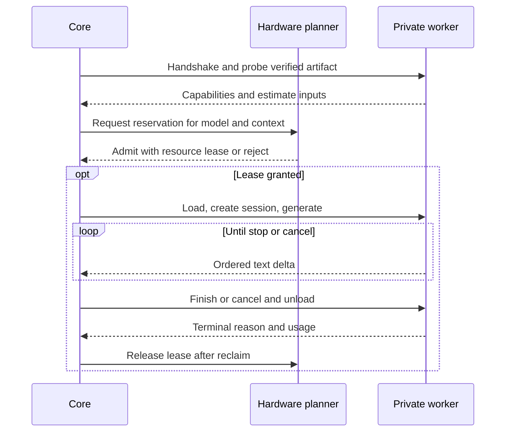

# Inference engine

Ship one private worker linked against one tested llama.cpp revision. The Rust core owns sessions, deadlines, admission and authorization. The worker owns tokenizer and template execution, mapped weights, sampler, KV buffers and all engine handles. A worker crash can lose an in-flight generation. The core records a terminal failure and leaves completed turns intact. Restart requires a fresh handshake and a new request ID.

## Worker protocol

Use inherited anonymous pipes between parent and child only. Each frame carries a length prefix followed by bounded UTF-8 JSON. Stdout carries frames only. Stderr diagnostics are bounded and redacted. Reject oversize or invalid frames before allocating payload memory. Start with a version negotiation and boot nonce, then return engine revision, build options, device identifiers and limits. Verify nonce, protocol major, message sequence, worker lifetime and request ownership before accepting any event. Neither the nonce nor a pipe makes an unconfined native parser safe. Apply platform containment and keep network, shell and credentials outside this worker.

The proposed v1 frame starts with an unsigned 32-bit big-endian byte length, then exactly that many UTF-8 bytes. Reject length zero or greater than 1 MiB before allocating. EOF inside the prefix or payload is a truncated-frame error. EOF between frames before the terminal event is an interrupted run. A test payload of `{}` is encoded as `00 00 00 02 7B 7D`: framing accepts it and message-schema validation rejects it. A golden hello body is shown below. Generate a fresh random 128-bit nonce for each launch. Reject syntactically valid messages that are invalid for the current worker state.

```json
{"type":"hello","versions":[{"major":1,"minor":0}],"nonce":"afcb26831b679a7621eabc53e375cb3a"}
```

| Core request | Worker reply or invariant |
|---|---|
| Discover, probe manifest, estimate plan | Answers include format and architecture allowlists, tokenizer/template digest, precision, context bound, per-pool byte estimates, feature predicates and unsupported reasons |
| Load verified artifact, unload handle | Accept only core-issued artifact identities resolved inside managed read-only storage. A load either produces an opaque worker-lifetime handle or releases partial allocations |
| Create session, generate | Bound messages, context, max output, sampling and queue depth. Use engine tokenizer for exact prompt length. Reject over-context requests before generation. Reject unsupported sampling, tool or schema options explicitly |
| Stream deltas and finish | Emit ordered, monotonic events, valid UTF-8 text, final token counts and stop reason. A delta may contain multiple tokens. Only one terminal result wins the core state transition |
| Cancel, timeout, health, metrics | Control channel processing remains responsive while decoding. Stop at a safe token/batch boundary. If the child exceeds its grace period, terminate and reap it. Return memory, prefill/decode timings and count units with scope |
| Close session, shutdown | Release session KV, sampler and mappings. Reclaim via process exit when unload cannot be proven. A new worker may never reuse an old handle |

A bounded producer/consumer queue prevents a slow UI retaining the entire stream. Reserve capacity for terminal and control messages; if the worker cannot drain within deadline, cancel. Never serialize tensors, weights or KV across JSON. mmap the private content-addressed file where supported. Evaluate binary encoding, transferable file handles or shared memory only if profiling identifies a hot copy. Direct FFI in the core enlarges the crash domain and pins its ABI. FFI inside the worker confines engine-specific pointer lifetimes and makes a binary pair replaceable together.



## Compatibility matrix

| Input and requested feature | First worker | Subsequent candidates |
|---|---|---|
| Single verified GGUF, approved dense text architecture, tested quantization | Qualify explicit tuples for CPU; match build ISA and OS | GPU or hybrid placement requires a separate smoke and memory test |
| HF safetensors, tokenizer/config bundle | Unsupported import for execution; no automatic conversion | mistral.rs worker for an enumerated architecture with a complete pinned bundle |
| ONNX, multimodal GGUF/projector, sharded inputs | Return typed unsupported reason | Dedicated format validation, media decoder isolation and matched fixtures before enabling |
| Adapter | Reject as a base model | Validate parent digest, target modules, tensor shape, engine adapter format and scale; verify against reference outputs |
| Tools or structured JSON | Only expose when model/template/parser and output constraints are qualified together; application validates every proposed action | Capability test includes malformed outputs, truncation, multiple calls and unsupported schemas |
| Multiple sessions and cache | Distinct logical histories, one active generation, one model resident; bound output and queue | Partition KV and prefix caches by model, template, parameters and tenant/security scope; never expose another session's prefix |

Classify failures as incompatible input, insufficient resources, invalid wire version, corrupt artifact, timeout, cancelled, worker crash or unsupported capability. Before load, return fitting alternatives ranked locally. During a stream, expose partial output as interrupted; prohibit silent restart, continuation with a different model, or cloud failover. A new local plan requires user-visible changes to context, quantization or model identity.

## Backend-owned optimizations

llama.cpp already exposes quantization, hybrid offload and multiple compute backends; its benchmarking tool exposes flash attention, KV types and NUMA controls. Evaluate specific build options directly. The server's continuous batching, speculative decoding and affinity options are evidence that implementations exist upstream, not a promise that our C API shim reproduces its server scheduler. Keep single-session defaults until a workload demonstrates contention. [Engine](https://github.com/ggml-org/llama.cpp/tree/c6a0ff11a0fe16ac1a2eb569190934593a2b3670) · [benchmark options](https://github.com/ggml-org/llama.cpp/blob/c6a0ff11a0fe16ac1a2eb569190934593a2b3670/tools/llama-bench/README.md) · [server options](https://github.com/ggml-org/llama.cpp/blob/c6a0ff11a0fe16ac1a2eb569190934593a2b3670/tools/server/README.md)

mistral.rs documents PagedAttention, prefix caching and selected FlashAttention paths. Compare the same model and representation before adopting a second engine. Pool allocation, SIMD dispatch, device kernel selection and cache layout stay within each backend. Only promote an optimization after matched quality, memory, cancellation and throughput checks. [mistral.rs](https://github.com/EricLBuehler/mistral.rs/tree/52b3c49b2021e77bbd80bcbbbcfae534a89decd0) · [benchmark gates](BENCHMARK_PLAN.md)
