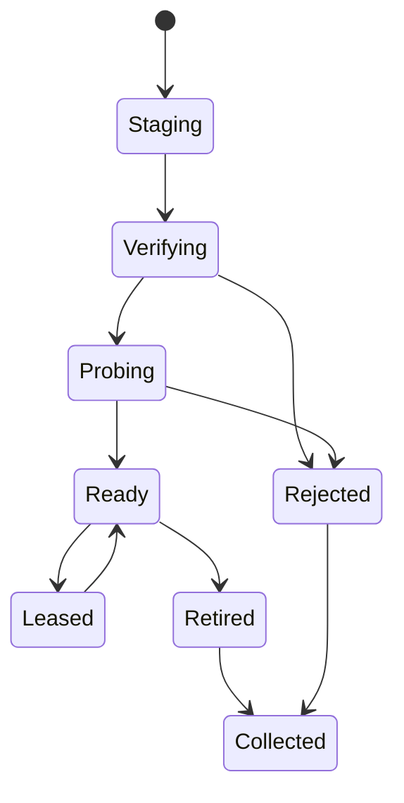

# Model management

The catalog owns model identities and verified manifests. The blob store owns immutable bytes under content digests. Sessions pin a manifest revision and lease the required blobs. A user's local filename is display metadata only. For the MVP, copy an explicitly chosen local, single-file GGUF into managed storage. This prevents a replaced external file from changing the meaning of an installed model. The source remains user-owned.

## Manifest v1

| Field | Contract |
|---|---|
| schema_major, schema_minor, id, revision | Reject unsupported major and unknown required features. Identity is a local immutable revision; mutable display aliases resolve before loading |
| source, source_revision, retrieved_at | Local import or allowlisted catalog plus immutable upstream identity, where known. Do not send local paths, tokens or private revision names to telemetry |
| files[] | Role, expected size, SHA-256, format and safe display name; content-addressed lookups only. Identify weights, tokenizer, template, projector or adapter explicitly |
| architecture, quantization, context, modality | Parser observations with source and limits; reconciliation with worker probe must succeed. Never trust catalog metadata as a memory budget |
| license | Model identifier or “unknown”, source and optional recorded acknowledgment. Separate model, tokenizer, adapter and dataset terms; block redistribution on unknown rights |
| compatibility | Engine/build qualification, device/backend, tested limits and fixture receipt. An absent tuple stays unqualified |
| adapter_base | Exact base revision/digest, tensor dimensions, target names, scaling and conversion recipe when applicable |

Example identities in this design are illustrative. For a local import with no publisher-signed hash, the computed SHA-256 identifies the exact bytes and detects later corruption. It does not authenticate the author. Display that distinction before loading.

## Crash-safe installation and retirement

1. Reserve temporary and final storage, including copy-on-import and retained old revisions. Open source as a regular file without following unexpected reparse/symlink paths. Bound sizes and metadata counts, strings, tensor offsets and arithmetic; refuse scripts, pickle, archives and remote code. Parse untrusted content in a low-authority worker before granting a ready alias. Hub scanning has known limitations. [Hub security documentation](https://huggingface.co/docs/hub/security-pickle)
2. Stream to a private temporary file on the destination volume, hash while writing, validate length and trusted digest if provided, flush. Create a digest path without clobbering another writer; if already present verify its identity before sharing. Sync directory metadata where available. Record `Ready` only after bytes and manifest exist.
3. Use a database transaction to register revision, refs and display alias. A retry on the same digest is idempotent. A crash before commit leaves unreferenced blobs/staging for startup reconciliation. A missing blob after commit invalidates readiness; re-import or repair. Concurrent installs converge without pointing an alias at partial data.
4. Updates stage a new revision and atomically swap an alias. Existing sessions retain leases on the old revision until release. Delete removes the alias first, then garbage-collects only unreferenced, unleased blobs under an exclusive GC/install coordination lock. Handle open Windows file mappings by retrying collection after unload. A failed delete never removes a still-referenced blob.

## Subsequent catalog and download support

Perform Hugging Face search or browse only on an explicit network action. Resolve a mutable model name to a specific revision, list variants with size, disclosed license, expected digest and compatible hardware plans, then let the user select. Download to the same staging pipeline with bounded redirect/size limits. Persist bytes received, expected object identity and strong ETag/revision. Resume with Range/If-Range only if byte-range response and artifact identity match; otherwise discard the partial response and restart. Authenticate to private catalogs with scoped credentials. Never execute model repository hooks or enable remote custom code.

Tests include digest mismatch, overflowing metadata, duplicate import, changing source during copy, failed final rename, interruption at each boundary, disk full, pinned old revision after update, and concurrent import/delete. For adapters verify base digest, shapes, tokenizer and conversion provenance before exposing activation. A declined or incompatible selection leaves existing active sessions intact. [Fit decisions](HARDWARE_INTELLIGENCE.md) · [worker compatibility](INFERENCE_ENGINE.md)
