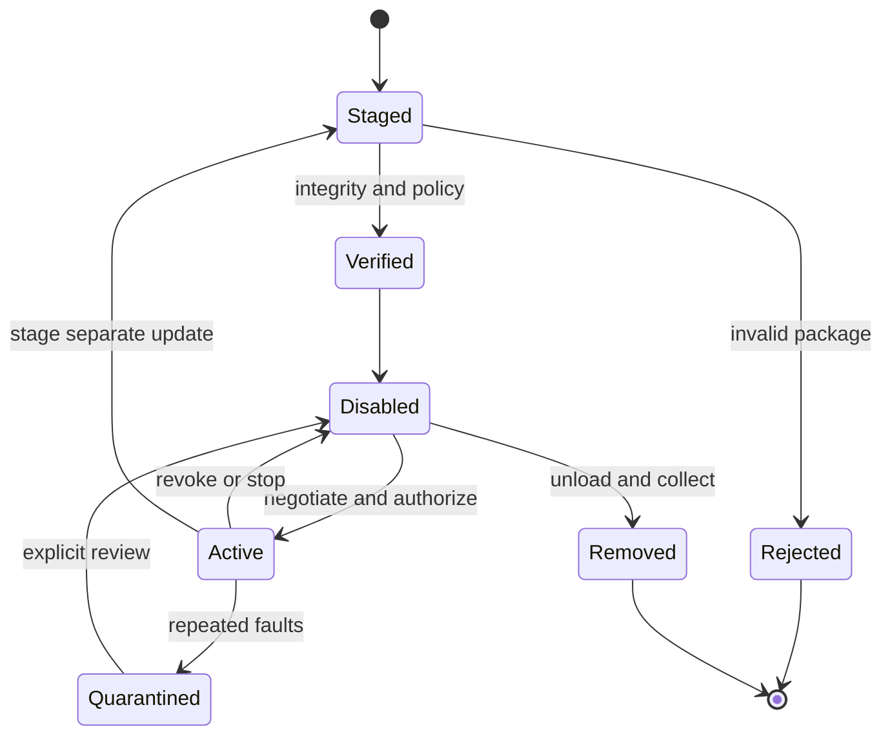

# Plugins and skills

Extensions are a post-MVP feature. The built-in read tool establishes the host policy contract first. Each later extension receives a principal distinct from the user, has an immutable installed digest and may request only capabilities in its negotiated manifest. A prompt-based skill is versioned untrusted content. Installing one grants no tool authority.



## Extension contract

Example proposal for an SDK manifest. Resolve the digest from a signed outer index or separately supplied lock record to avoid a self-referential package digest.

```json
{
  "manifest_version": 1,
  "id": "org.example.wordcount",
  "version": "1.2.0",
  "kind": "wasm-component",
  "host_api": {"major": 1, "minimum_minor": 1},
  "entry": "component.wasm",
  "exports": ["tool.wordcount.v1"],
  "requests": ["input.text"],
  "dependencies": []
}
```

Reject unsupported major versions, missing required imports, duplicate IDs, absolute archive entries, path traversal and link entries. Bound unpacked byte and entry counts. Resolve dependencies to a local digest lockfile, reject cycles, enforce trust policy for each publisher and do not execute install scripts. Signature verification identifies a publisher. Runtime authority still requires a grant. An update is staged in a new directory, verified and atomically activated after smoke tests and a displayed permission diff. Retain the last compatible digest for rollback. Revocation cancels new invocations, interrupts running work and drops handles. Garbage-collect unreachable artifacts after leases expire.

| Mechanism | Binding and limits | Candidate uses |
| --- | --- | --- |
| MCP | Initialize a pinned protocol revision, negotiate capabilities, list declared tools/resources, wrap schemas and treat descriptions/results as untrusted. A changed tool list triggers re-discovery and policy review. | User-selected tool servers and retrieval connectors. |
| WebAssembly | Evaluate Wasmtime components and typed WIT worlds. Give only requested host functions and bounded input. No ambient filesystem, environment or socket imports. Enforce memory/table/instance limits, fuel or epoch interruption, host-call deadlines and bounded outputs. | Portable text transforms, project tools and workflow steps. |
| Native helper | Separate executable, private framed versioned IPC and independently qualified OS confinement. Refuse third-party native code if containment is missing. No in-process dynamic loading. | Device probes or native backend adapters requiring vendor libraries. |
| Declarative skills | Immutable templates and input schemas, versioned references to existing tools. Resolve each requested operation through the same policy path. | Repeatable workflows. Defer arbitrary executable UI plugins. |

Wasmtime supplies sandboxing primitives, while the host defines which imports and resources it exposes. Interrupting guest code alone cannot unblock a stuck native host function. Evaluate a killable helper for blocking work. [Wasmtime security](https://docs.wasmtime.dev/security.html)

## MCP boundary

Use local stdio for explicitly approved executables and Streamable HTTP for explicitly approved endpoints. Pin the negotiated MCP revision independently of Lora's worker protocol. Local stdio servers run as processes with the OS rights the host grants them. Advertising a single tool cannot constrain an unconstrained binary. Launch with a scrubbed environment, explicit executable path and minimal sandbox, or require a documented trusted-local-server exception. Do not pass provider keys to extension processes.

For HTTP, bound redirects and timeouts, validate TLS and prevent unapproved private-address or metadata-service destinations. Apply the MCP authorization flow and audience binding for protected resources. Treat server discovery, resource reads and each tool action as separate permission checks. Distinguish transport/authentication errors, protocol incompatibility, tool-level errors and a lost response after possible effects. Retry only demonstrably idempotent operations. [MCP transports](https://modelcontextprotocol.io/specification/2025-11-25/basic/transports) · [MCP authorization](https://modelcontextprotocol.io/specification/2025-11-25/basic/authorization)

## SDK and qualification

Expose versioned request, observation, cancellation and error types to extension authors. Use a compatibility fixture suite and signed sample extension before promising a stable SDK. Independently version MCP adapters, WIT worlds and native IPC. Reject unknown required features, ignore optional fields only when declared additive, and retain both major versions only for a published transition window. Test dependency cycles, tampered assets, oversized results, infinite loops, blocking host calls, revoked permissions, tool schema drift, failed updates and uninstall during an invocation. See [security architecture](SECURITY_ARCHITECTURE.md).
