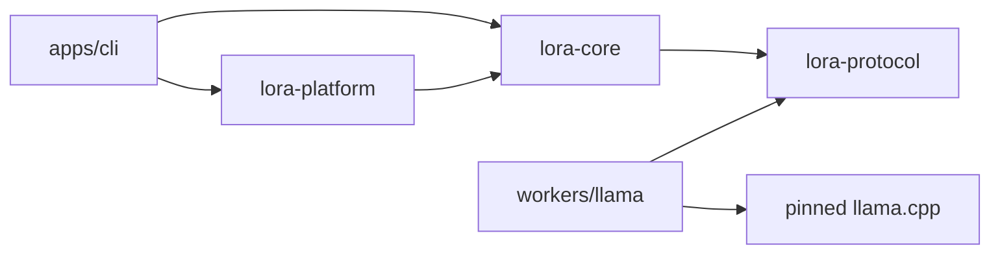

# Repository structure

## Today

The repository carries design specifications in `docs/`, architectural decisions in `docs/adr/`, and project artwork in `docs/assets/`. Documentation validation, packaging and distribution are the only executable delivery path on this branch. See the [workflow guide](CI_CD.md) and [contribution guide](../CONTRIBUTING.md).

## First implementation

The following tree is proposed. Add each path with its first working consumer.

```text
apps/cli/                 trusted terminal and composition root
crates/lora-core/         app services, registry, policy, HIE, agent, store ports
crates/lora-platform/     handle-based OS access, child lifecycle and sensors
crates/lora-protocol/     worker wire types, framing and golden messages
workers/llama/            executable shim, native build pin and license notices
tests/fixtures/           small, redistributable or generated adversarial fixtures
benchmarks/               case manifests, runner and machine metadata
docs/                     design, decisions and qualification procedures
.github/workflows/        checks and releases
```

One workspace lockfile covers Rust targets. Record the native source revision, patch set, CMake flags, compiler version and target CPU in a sibling build manifest. Keep generated bindings pinned to the same C headers as the worker library. Avoid a separate crate per screen, agent role or storage table. Split a module when a build feature, platform boundary, public contract or independent release makes the split pay for itself. [Cargo workspaces](https://doc.rust-lang.org/cargo/reference/workspaces.html)

## Compile-time dependency graph



The platform crate implements ports defined by the core. The CLI injects those implementations. A separate native build may consume protocol golden fixtures instead of linking the Rust crate. The host launches the worker at runtime without importing its native library. Keep the protocol independent of Tokio, SQLite and front-end types so a fake worker can test compatibility and recovery.

Add `apps/desktop` and `apps/api` as composition roots only when those interfaces ship. An optional trainer and extension host receive separate build targets, dependency audits and packaging gates. Keep large model blobs, secrets, machine-specific configuration and raw private prompts outside Git.

## Ownership and change policy

A protocol change needs fixtures for current and previous compatible minors. Additive fields must define defaults; an incompatible semantic change needs a new major and early negotiation failure. Storage migrations take a backup and handle a version newer than the running binary by refusing writes. A product behavior change updates the related specification, ADR and acceptance case in the same change.

Use feature worktrees off the reviewed base. A worktree gives each branch its own checkout and index while sharing Git objects. Keep build caches and downloaded weights outside the tracked tree. Each merge request records affected OS/architecture combinations and includes a CI reproduction command. Architecture docs use the requested uppercase filenames, ADRs use numbered lowercase filenames, and links are repository relative.
