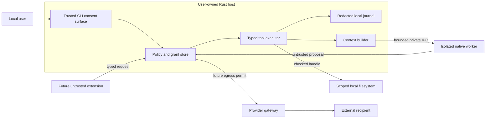

# Security architecture

The core mediates every transfer between user-selected resources, model inputs and destinations. The first release runs under an ordinary local user account with no network feature, third-party plugins or privileged helper. The model can propose a bounded file read only in Read-only Assistant mode.

## Threat assumptions and objectives

Protect user files, model/data digests, prompts, local credentials, system integrity and the distinction between a proposal and authorized execution. Assume hostile model weights, injected documents, forged tool metadata, malformed frames, accidental destructive intent and a malicious browser tab. Treat a compromised worker or extension as an attacker within the scope of its OS-visible access. A same-user process may already read user-accessible files or manipulate the terminal. Full protection from a compromised account, kernel, debugger or administrator is outside this trust model.

| Abuse case | Enforced boundary | Evidence required before enabling |
| --- | --- | --- |
| A document asks the model to send credentials | Mark provenance, isolate untrusted text, validate typed proposal, deny ungranted tools/destinations. Network is absent in MVP. | Injection fixture cannot expand scope or reach a canary endpoint. |
| Directory escape or stale authorization | Handle-relative open, strict alias policy, short-lived capability, fresh epoch at dispatch and data release. | Race, link, reparse-point, revoked-grant and concurrent-read tests. |
| Malformed GGUF exploits native parser | Bound header counts/offsets and sizes, hash imported bytes, run parser in restricted helper, limit child lifetime and memory. A digest proves identity only. | Fuzz and truncate fixtures, deny child access to sentinel files and sockets. If confinement is unqualified, restrict imports to qualified trusted digests or withhold the feature. |
| Worker forges a host command | Private inherited handles, boot nonce, framed/size-capped messages and strict worker-role message schema. Host owns validation and grants. | Reject wrong nonce/major, oversized or late frame and forged event. |
| Browser or other app invokes service | No listening port in MVP. Later bind loopback explicitly, authenticate every request, validate Host/Origin, limit scopes and lifetimes. | DNS rebinding, cross-origin, expired token and reflected credentials tests. |
| Untrusted plugin or poisoned update | Pin immutable digests, verify signatures where a trust policy exists, sandbox and renegotiate permissions on update. No native module in core process. | Deny unlisted imports, excess resources and changed-manifest grants. |
| Sensitive data enters logs or a crash dump | Redacted receipts by default, no environment dumps, control characters escaped, bounded local diagnostics reviewed before export. | Canary secret absent from logs, telemetry, errors and default exports. |
| Destructive command or privilege escalation | No shell or privileged helper in MVP. Later require scoped verb, immutable preview, one-use consent and independent OS authorization. | Attempt command substitution, argument substitution, helper replay and changed target. |

## Grant evaluation

An internal grant contains subject, tool/version, operation, allowed resource or destination, allowed mode, issuer, run/session ID, expiry and revocation revision. Keep session grants in memory. A future persistent grant requires explicit user creation and is visibly listed with last use, expiry and a revoke action. Bind it to the resource identity and application/tool version policy. A string supplied by a model or external client can never instantiate a grant.

| Category | Policy default and escalation |
| --- | --- |
| Read system information | Low for coarse resource counts visible to the user. Detailed diagnostics and identifiers need explicit selection. |
| Read files | Medium. User chooses the root, the intended use and finite grant lifetime. Reject unapproved resources and secret-bearing resources excluded by policy. |
| Write files | Medium for a previewable edit within scope. High for deletion, bulk replacement, overwrite after changed precondition or irreversible changes. |
| Execute commands | High by default. Later typed non-shell operations can receive narrower policies. Shell strings never inherit a broad persistent permit. |
| Access network | Separate permission for recipient, purpose and disclosed data classes. Discovery, downloads, tool traffic and cloud prompts require independent scopes. |
| Control applications or access screen | Distinct input/capture grants bound to the app/window and OS consent. Stop on scope or focus changes. |
| Manage services or perform privileged operations | High. Narrow typed helper verbs, fresh user approval and OS authorization per operation. |

For each action check subject, mode, resource, current grant and budget. A low-risk action may use a scoped session grant. A medium-risk action presents a preview when it lacks a suitable active grant. Irreversible, destructive and privileged actions always require an expiring one-time approval naming effects, target identity and arguments. A dry run reports the plan and preconditions without executing the effect. Compute the approval digest over canonical typed arguments and resolved identities. Compare-and-consume a one-time grant in a durable transaction before dispatch. A changed precondition invalidates the approval.

## Secrets, IPC and audit

The host alone opens the local database and OS credential store. Future provider secrets are referenced by opaque IDs and held only in the gateway for the duration of an authorized request. Use Windows Credential Manager, macOS Keychain or a qualified Linux Secret Service. If the chosen mechanism is unavailable, permit explicit ephemeral entry or disable saving. Restrict application files to the owning account and rely on host disk encryption for at-rest protection against physical theft unless a separately designed encrypted mode exists.

Use the inherited private worker channel with a per-launch nonce, maximum frame length checked before allocation, version handshake, deadlines and per-request cancellation. Close unrelated handles, scrub inherited environment, use a fixed executable location and separate stderr diagnostics from protocol. Constrain network, files, memory and descendants with platform mechanisms. A child without such constraints still shares the user's OS authority. Qualify each advertised sandbox behavior separately. See [OS integration](OS_INTEGRATION.md).

Journal monotonic sequence, run ID, actor, policy revision, action digest, resource alias, decision, time and outcome. Digest sensitive short strings with a per-install keyed construction when correlation is needed. Do not persist raw prompts, files or token values in the audit trail. A local account owner can tamper with a local journal. Bound retention, expose export/delete, and record interrupted actions distinctly. On audit failure refuse new tool effects, while allowing cancellation and recovery. Incident recovery revokes affected grants/credentials, quarantines the package digest, interrupts dependent runs and preserves only user-approved diagnostic evidence.
