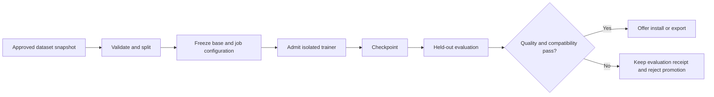

# Adapter Studio

Training starts after local inference, artifact identity, hardware admission and evaluation are dependable. Ordinary local inference requires no Python or trainer installation. A training job reads an immutable base checkpoint and an approved dataset snapshot; only its job directory is writable. A trainer failure cannot change the default model, conversation history or active adapter alias.

| Operation | What changes | Product boundary |
|---|---|---|
| Pretraining / full fine-tuning | Learn weights from initialization / update all pretrained weights | Outside the product plan for general consumer PCs |
| LoRA | Freeze the base; optimize low-rank updates on selected matrices | First experimental trainer candidate on one exact tuple |
| QLoRA | Train adapters through a frozen quantized base using a supported training implementation | Later independent validation; a quantized inference file does not imply trainability |
| Adapter inference | Apply a compatible trained update at serving time without overwriting the base | Needs exact base lineage, layer targets, tensor shape and runtime format validation |
| Merge | Materialize a new base-derived artifact with adapter updates applied | Explicit export to a new revision; check license, output footprint, numerical parity and possible requantization loss |

## First experiment

Try Apple Silicon, a pinned PMetal build, a pinned Qwen/Qwen3-0.6B text checkpoint and plain LoRA on a consented, redistributable text fixture. PMetal's README demonstrates this model and a JSONL training invocation. The candidate stays experimental until tested on a recorded Mac model, RAM budget and OS version. First test inference in the trainer's own supported format; separately test conversion and loading against the same base lineage in Lora's pinned llama.cpp worker. If conversion is unavailable, keep trainer-local evaluation and export clearly marked. [PMetal example](https://github.com/Epistates/pmetal/tree/75be3f316cab1975249bf7d1083230d8a1c5ce1c)

Compare MLX LM as a reference. An optional Python bridge can unlock MLX LM or a later PEFT configuration but must run as a separately installed, locked, offline job environment. No environment mutation or model-code downloads at training time. Candle and Burn provide tensor and autodiff components; owning the model implementation, optimizer parity, checkpoint layout and exporter would add validation work. Kiln targets an integrated live-training server. loractl's real Krea 2 diffusion target does not validate text adapters. [Backend comparison](COMPETITIVE_RESEARCH.md)

## Job contract and recovery

The immutable configuration records base revision, tokenizer/template hashes, dataset license and digest, train/validation/test split identities, deduplication version, seed, rank, alpha, dropout, target layers, learning rate/scheduler, epochs, optimizer, precision, context, microbatch and gradient accumulation. Validate schema, row lengths, encodings and tensor dimensions; reject empty or overlapping splits. Split by source/conversation before chunking to prevent leakage. Display estimated disk, weights, activations, optimizer and checkpoint costs before launch. Require explicit data inclusion; private chats never become training examples by default.

The scheduler reserves the trainer exclusively for the first experiment. The worker writes atomic versioned checkpoints with optimizer/RNG/step state and parent configuration digest. Reject resume on mismatched base, tokenizer, dataset ordering or engine revision. Cancellation acknowledges only after checkpointing safely or terminating the process; incomplete checkpoints stay invisible. Stream bounded progress and evaluation summaries without dataset text in ordinary logs. Distinguish OOM, rejected schema, incompatible weights, cancelled, lost worker and failed evaluation.

## Promotion gate

Run untuned base and candidate on fixed held-out tasks, scoring task success, schema validity, regressions on general tasks and blinded qualitative preference. Record sample counts, uncertainty, per-task failures, inference latency and peak memory alongside training loss. Use an untouched test set for the promotion decision. Exercise unload/reload and compare adapter-enabled logits or fixed deterministic fixtures with the trainer reference under predeclared tolerances. Evaluate quantized serving separately. The candidate may be registered as experimental, activated only with explicit selection, exported with license/provenance, or rejected. Rollback switches the alias to the previous revision and retains the rejected job receipt. No published support tuple exists until these checks pass.
